# 📍 waypoints: the user guide

This guide shows how to use waypoints, step by step. You don't need to be technical. The trip in the
pictures, *Japan in spring* with Ana, Ben and Chloé, is made up.

## Contents

1. [What waypoints is](#1-what-waypoints-is)
2. [Install it](#2-install-it)
3. [Your first trip](#3-your-first-trip)
4. [Before the trip](#4-before-the-trip)
5. [During the trip](#5-during-the-trip)
6. [After the trip](#6-after-the-trip)
7. [Sharing with your group](#7-sharing-with-your-group)
8. [Keeping your trips safe](#8-keeping-your-trips-safe)
9. [Privacy, in plain words](#9-privacy-in-plain-words)
10. [Settings at a glance](#10-settings-at-a-glance)
11. [Questions](#11-questions)

## 1. What waypoints is

waypoints keeps your trips on your phone: the bookings, a day-by-day plan, the places you want to see
and the money you share with the people you travel with. There is no account to make, and it works
without internet, on the plane or in the mountains.

When you go with other people, you share the trip with them. Everyone keeps their own copy, and
changes come together on their own.

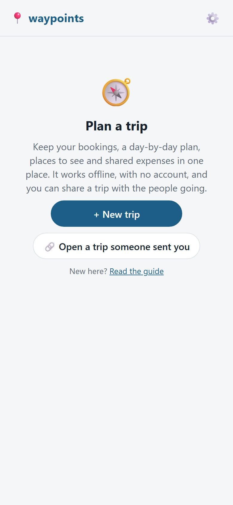

## 2. Install it

Open the app address (it is at the top of the [README](README.md)) on your phone, then add it to your Home Screen. It then
opens like any other app.

- **iPhone:** open the address in Safari, tap **Share**, then **Add to Home Screen**.
- **Android:** open the address in Chrome, tap the ⋮ menu, then **Add to Home screen** or **Install app**.

Why it matters:

- The app opens offline once it's on your Home Screen.
- Browsers may clear the data of websites when the phone runs low on space. An app on your Home Screen
  is much less likely to lose its data. Keep a backup anyway (see [section 8](#8-keeping-your-trips-safe)).

## 3. Your first trip

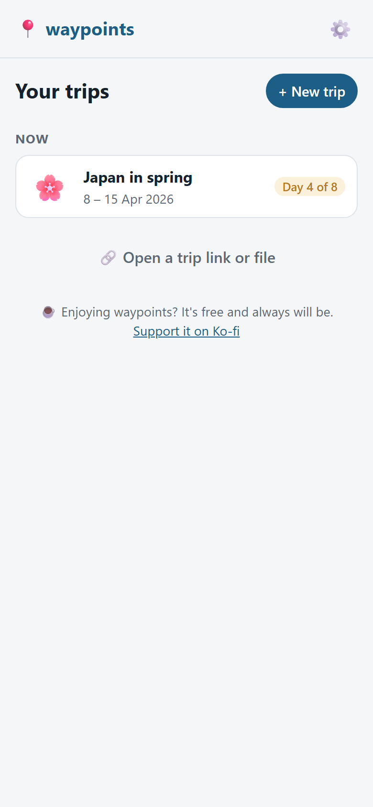

Your trips are listed here, as **Now**, **Coming up** and **Past trips**. Tap **+ New trip** to start one.

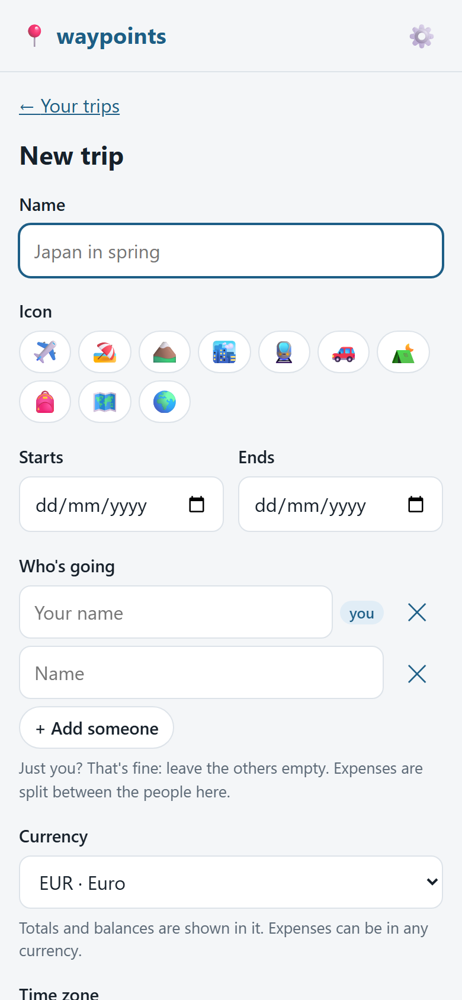

Fill in:

- the **name** and the **dates** of the trip,
- the **currency** you count in (the one your shared expenses are added up in),
- the **time zone** where the trip happens,
- **who's going**. Type each name. Your own name is suggested first.

You are the first row in the list, marked "you". The app uses that for your own reviews, what you paid and
what you owe. If someone sends you a trip link, it asks which traveller you are when you open it. A trip
file doesn't ask: pick yourself under **Which one are you?** on the 🧳 Trip tab.

If someone sent you a trip, tap **🔗 Open a trip someone sent you** on the welcome screen, or open their
link or file. See [section 7](#7-sharing-with-your-group).

Inside a trip, **‹** at the top left goes back one screen. On the five tabs at the bottom, it takes you back to your trips.

## 4. Before the trip

A trip has five tabs at the bottom: 🗓️ Plan, 📍 Places, 💶 Money, 📎 Files and 🧳 Trip. Most of what you
plan goes in from the Plan tab, with **+ Stay**, **+ Transport** and **+ Activity**.

### Stays, transport and activities

- A **stay** is a hotel, an apartment or any bed for the night, with check-in and check-out.
- **Transport** is a flight, train, bus or ferry.
- An **activity** is anything you do: a visit, a dinner, a tour.

Each one can have an address, a phone number, a booking link and a **booking reference**. Tap a booking
reference to copy it, which is handy at the desk. Tap a phone number to call. An address gets **🧭 Directions** and
**🗺️ Google Maps** buttons, plus **🍎 Apple Maps** on iPhone and iPad.

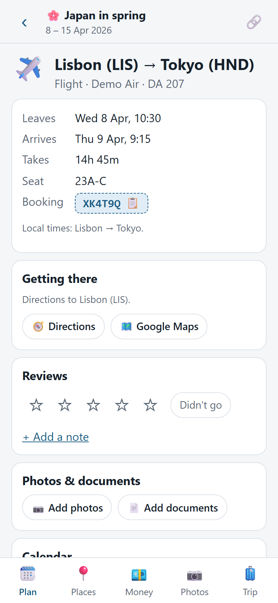

### Cities, airports and time zones

Start typing a city and pick it from the list. It has every town of 15,000 people or more, and works
offline. Cities you already use in the trip come first.

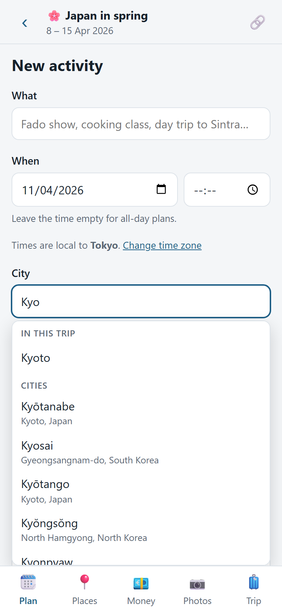

- For flights, type a city, an airport's name or its code ("nrt", "heathrow"). It reads "Tokyo (NRT)".
- Picking a city or an airport sets its **time zone**. A flight leaves at 10:30 Lisbon time and lands at
  09:15 Tokyo time, and both come out right.
- Your journeys decide the time zone of what you add after them. The day after a flight to Japan, a new
  activity is in Japan time.

### Addresses

Address fields suggest the addresses already in the trip, such as your hotel's for an activity there, and
fill in the city too.

You can also turn on **online address search** in Settings → **Address search**. It looks up any address
as you type, using OpenStreetMap. It needs internet, and what you type in the address field is sent to
it. It's off until you turn it on.

### Photos and documents on a booking

On any stay, journey, activity, place or expense, you can add photos and documents: a ticket, a
boarding pass, a receipt.

- Documents are kept on your phone, so they open at the gate without signal.
- Flights bought together share a booking reference. Give each the same reference, and a document added
  to one is **for every flight on that booking**. Untick it to keep a boarding pass on its own flight.
- Tick **Only on this phone** to keep something to yourself, such as a passport. It is never sent to
  anyone, and you can share it later.
- Photos are made smaller when you add them, which also leaves out where they were taken. The originals
  stay in your phone's gallery.
- Links and trip files can't carry photos or documents. They are shared only through a sync server
  (see [section 7](#7-sharing-with-your-group)).

### Places to see

The 📍 Places tab keeps the places you'd like to visit, grouped by city.

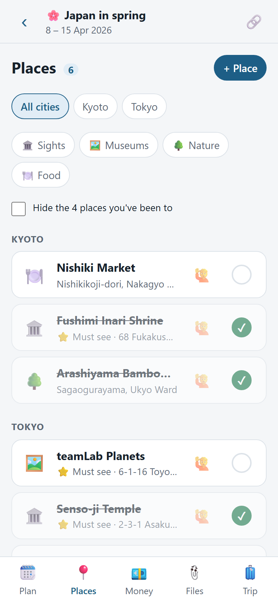

- Mark a place as **⭐ Must see**.
- Tick **✅ Been there** when you've visited.
- On a trip with two or more travellers, tap **🙋 I want to go** on a place (or the 🙋 button on its row) to
  say you'd like to see it. The row shows how many want to go, and the place page shows who. Tap again to
  take it back. Once any place has a vote, **Most wanted first** puts each city's most wanted places on top.
  With a sync server, it needs updating to the latest server version to share the votes.
- Tap **🗓️ Add to the plan** to turn a place into an activity on a day.
- Paste a Google or Apple Maps link to open the place on the map again later.
- With a sync server, a new place has a **Paste a Google Maps link** box: paste the link (in Google Maps,
  tap Share → Copy link) and tap **Fill in** to get the name, link and city filled in for you.
- With a sync server, **Import list** (above the places) brings in a shared Google Maps list: paste its link
  (in Google Maps, open the list, tap Share → Copy link), tap **Look it up**, tick the places you want and
  tap **Add**.

### Packing & to-do

Each trip has one shared checklist for what to bring and what to do before leaving. On the 🧳 Trip tab,
open the **🎒 Packing & to-do** card and tap **Open the list**. The card shows how many items are packed,
like "2 of 9 packed".

- Type in **Add an item** and tap **Add**. The same text can be added twice if you want two.
- Tap the box next to an item to tick it as packed, and tap it again to untick. Everyone in the group sees
  the same ticks. Unticked items are listed first.
- On a trip with more than one traveller, pick **Who's bringing it** to say who has it, or leave it on
  "Nobody yet".
- Under **Add from a template**, tap Beach, City, Hiking or Skiing to add a ready-made set of
  items. Items already on the list are skipped, and nothing is removed or changed.
- Tap an item's text to edit it, then **Save**, **Cancel** or **Delete**. A deleted item disappears for
  everyone in the group once you share the trip.
- With a sync server, the server needs updating to share the lists. Until then they stay on your phone, and
  links keep working.

### Calendar

On the 🧳 Trip tab, **📅 Download calendar (.ics)** gives you one file with every stay, journey and activity.
Open it on your phone to add them to Google or Apple Calendar. Download it again after changes: the events
are updated, not copied twice.

A single booking has its own **📅 Add to Google Calendar** link and calendar file.

## 5. During the trip

### Plan and Bookings

The 🗓️ Plan tab shows the day you're on and what's next. It names tonight's stay, with **🧭 Directions** and
**🗺️ Google Maps** buttons.

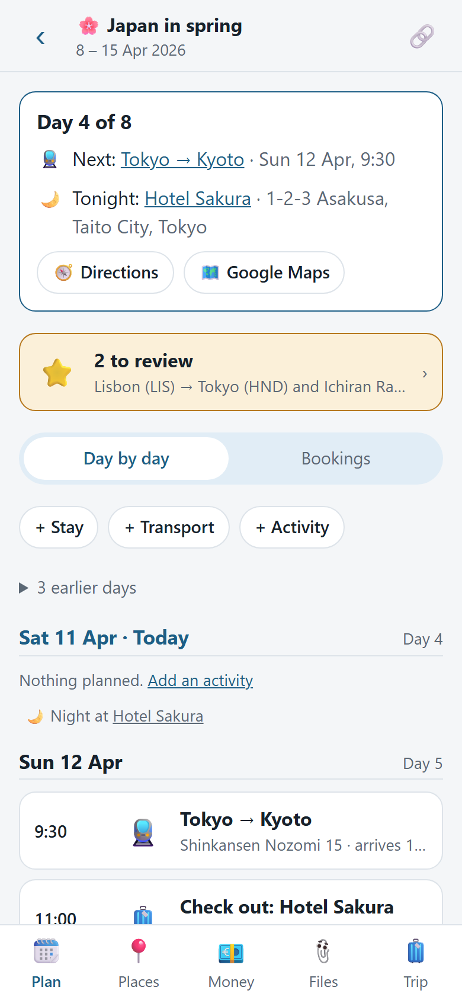

Below it, **Day by day** lists every day with where you sleep that night. **Bookings** lists every
reservation with its booking reference, so you can find one fast.

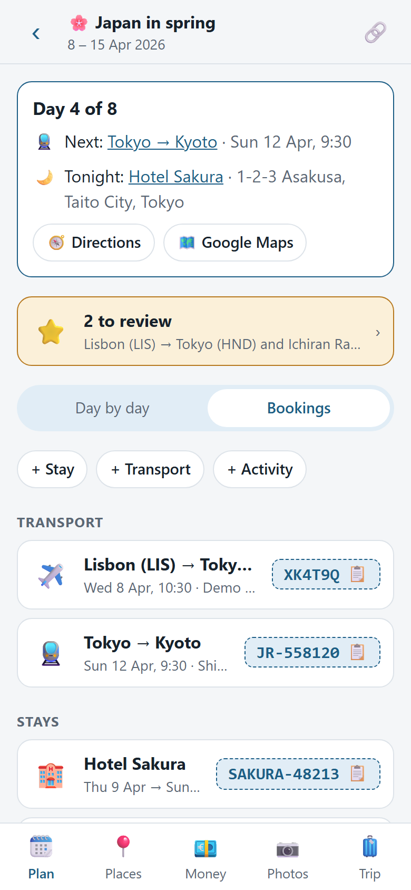

Journeys on one booking reference show together under **Connections**, with the layover between them and a
warning if they don't connect. Journeys more than a day apart, like a flight there and back, stay separate.

### Expenses

On the 💶 Money tab, add an expense: what it was, how much, in which currency, who paid and who shares it.

- Use **any currency**.
- **Split** equally between the people who share it, or by exact amounts.
- Say if it was paid in **Cash** or by **Card**. A new expense starts the way the last one in that
  currency was paid.
- Add a receipt photo to the expense.

### Exchanges and cash rates

Note each cash withdrawal or money exchange once, for example "10,000 JPY for €62.50", in **Exchange
rates**. Every cash expense in that currency is then counted at the rate you really got, fees included.
With several exchanges, the rates are averaged.

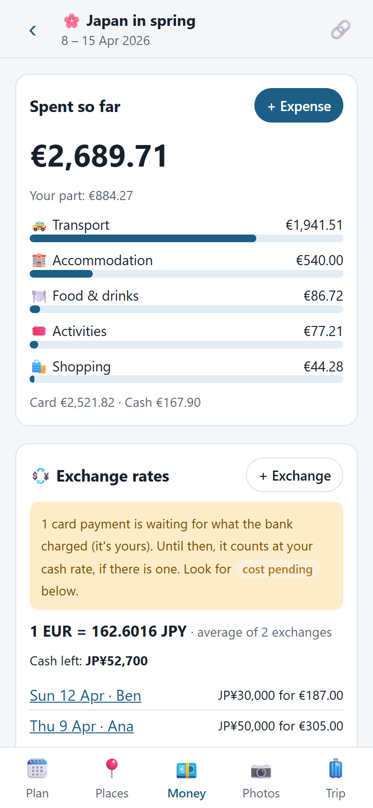

Under each foreign currency you also see the **cash left**: what you changed, minus what you spent in cash.

### Cost pending

A card payment uses what your bank charged, which you may not see yet. Save the expense without the
amount. It's marked **cost pending**, counts at your cash rate in the meantime, and the Money tab tells
you how many are waiting, and which are yours. Add the real amount when the bank shows it.

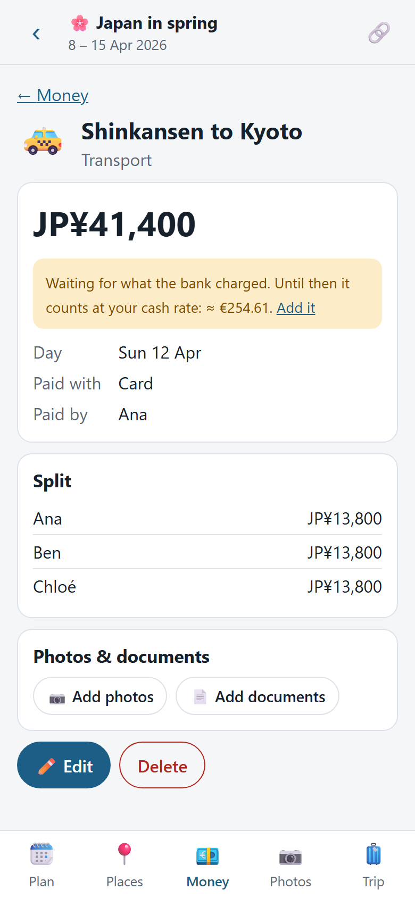

### Balances and settling up

Balances show who owes whom, with the fewest payments needed to settle up. Tap **Record payment** to note
a payment. It opens filled in, so you can change the amount: owe €100 and give back €35, and €65 stays
owed. **+ Payment** records any other payment.

### Files tab

The 📎 Files tab has a switch at the top: **Documents** (tickets, bookings, insurance) or **Photos**. Both
have a heading for what the files belong to, with the whole trip first, then stays, journeys, activities,
places and expenses. Each item has its own section under its kind. Photos show 3 per section; tap
**See all** to see all of that item's photos, by day.

To delete several, tap **Select**, tick them and tap **Delete**. **Select all** ticks everything shown.

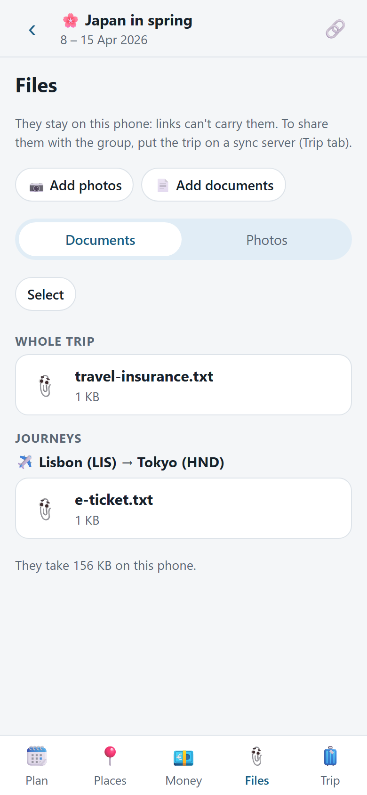

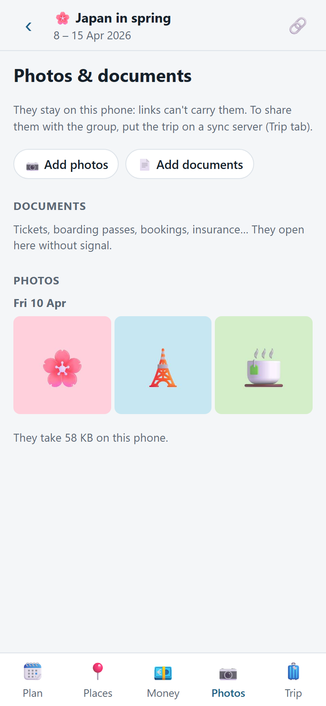

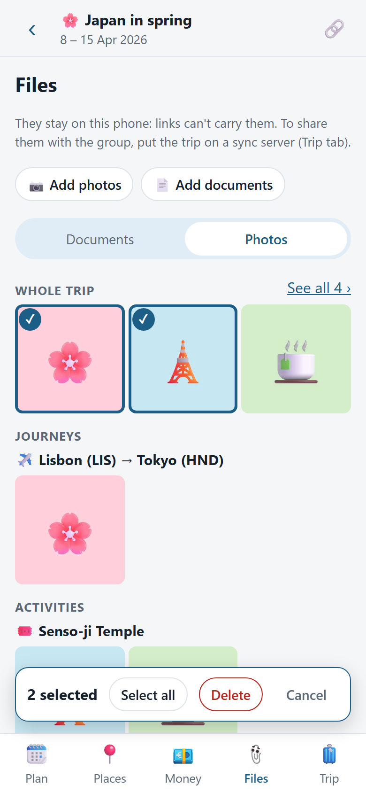

## 6. After the trip

### Reviews

Once something has started, its page has a **Reviews** card. Places get theirs once they're ticked
**✅ Been there**.

- Give **1 to 5 stars** and add a note, or tap **Didn't go**.
- Everyone writes their own, and they show side by side.
- Once things are over, the Plan tab says how many are **to review**. Tap it to rate them one after
  another. Afterwards you can see everyone's reviews, the latest or the top rated first.

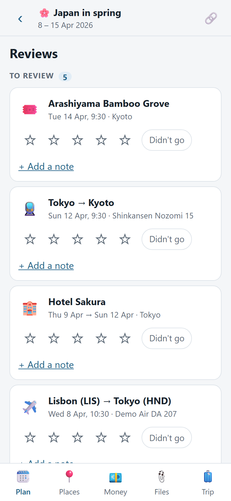

### Trip report

The report is the whole trip on one page: what it cost (by category, by day, who paid what), whether
everyone has settled up, the best and worst of the trip with everyone's stars and notes, the stays and
journeys, places you saved but never visited, a photo a day, and a few numbers to remember it.

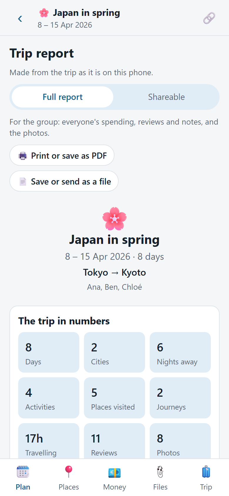

- Open it from the Plan tab once the trip is over, or from the 🧳 Trip tab to see the trip so far.
- Choose the **Full report**, for the group, or the **Shareable** one for anyone else. Shareable leaves
  out names, notes and photos, and what it cost unless you add it.
- **🖨️ Print or save as PDF**, or save it as a file that opens in any browser, to keep or send in a chat.
- On a trip kept on a sync server, the report is made once and kept there, so everyone opens the same
  one. If the trip changes afterwards, anyone can make it again.

## 7. Sharing with your group

Everyone in the group keeps their own copy of the trip on their phone. There are two ways to share it.

### With a link or a file

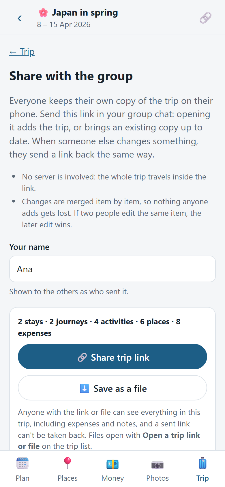

1. In the trip, tap 🔗. Tap **Share trip link** and send the link in your group chat. Or use
   **Save as a file** and send the file.
2. Opening the link adds the trip and asks which traveller you are. A file doesn't ask: pick yourself
   under **Which one are you?** on the 🧳 Trip tab.
3. Anyone can add things and send a link back the same way. Opening it **merges** the changes into your
   copy, item by item: new things are added, the newest edit of each item wins, and deletions are passed
   on. Opening the same link twice changes nothing, and links can arrive in any order.

Good to know:

- The whole trip travels inside the link. No server is involved.
- The app shows a **reminder dot** when you've changed things the group hasn't had yet.
- Trips with a lot in them make long links, and some chat apps cut them short. Send the trip as a file
  instead, and the others open it with **Open a trip link or file** on the trip list.
- Anyone with the link can see everything in the trip, including expenses and notes. **A link that's
  been sent can't be taken back.**
- Photos and documents don't travel in links or files.

### With a sync server

If someone you know runs a waypoints **sync server** (on a home computer, for example), changes reach
everyone by themselves, without links, and photos and documents are shared too. You join as a traveller:

1. The person who runs it taps **+ Invite someone** in Settings and sends you an invite link.
2. Open the link. It fills in the server and asks for your name.
3. When you make a trip, choose to keep it **on the server**, and tick the people on it. For a trip you
   already have, use **🌐 Put it on the server** on the Trip tab.
4. Changes made offline wait on your phone and go up the next time the server can be reached.
5. To leave a trip, use **Leave the trip** on the Trip tab. The trip stays with the others, with your
   expenses.

The server also reads Google Maps links for the people who use it, to fill in new places.

A trip on the server is seen only by the people on it. Links still work next to it, also for people who
aren't on the server. To run a server yourself, see [server/README.md](server/README.md).

## 8. Keeping your trips safe

Your trips live on your phone, and sometimes that's the only copy.

- **Backup:** in Settings → **Backup & transfer**, tap **⬇️ Export all trips** to save a file. To use it on
  another phone, or to get things back, tap **⬆️ Import a file** there. Importing merges, so importing the
  same file twice changes nothing. Photos and documents aren't in the file, only their names and captions.
- **Safety copies:** before removing a trip, or overwriting it with someone's changes, the app keeps a
  copy automatically. Find them under **Safety copies** in the same card. Download one and import it to
  get things back.
- **Removing a trip from this phone:** the 🧳 Trip tab has **Remove from this phone**. It only deletes the
  trip from this phone. The others keep their copy. A safety copy is kept.
- **Your browser clearing data:** it may do so when space is low, especially on iPhone. Add the app to your
  Home Screen, and in Settings → **Storage** tap **Request persistent storage**. Export a backup now
  and then anyway.

## 9. Privacy, in plain words

- **On your phone:** your trips, photos and documents, and your name. There are no accounts, no
  analytics and no ads.
- **Only if you use a link or a file:** whatever you send in the chat travels with it, and everyone who gets
  it can read the whole trip.
- **Only if you join a sync server:** the trips you put on it go to that server, which belongs to the
  person who runs it. They can read what's on it. Trips are hidden from other people on the same
  server, not from whoever runs it. Photos and documents marked **Only on this phone** never leave.
- **Only if you turn on online address search:** what you type in an address field is sent to Photon,
  a free OpenStreetMap search. Searching cities and airports never leaves your phone.
- Maps, calendars and booking sites are ordinary links. They open in their own apps when you tap them.

Without a sync server and without online address search, the app makes no requests to the internet.

## 10. Settings at a glance

Open Settings from the trip list. It has these cards:

- **Your name:** suggested as the first traveller on new trips. It stays on your phone.
- **Address search:** turn online address search on or off.
- **Sync server:** connect to a waypoints server, with an invite or as the person who runs it.
- **Backup & transfer:** export and import your trips, and your safety copies.
- **Storage:** how much space waypoints uses, and persistent storage.
- **Updates:** **✨ What's new** shows what changed in each version.
- **About:** the version, a link to this guide, and the project page.

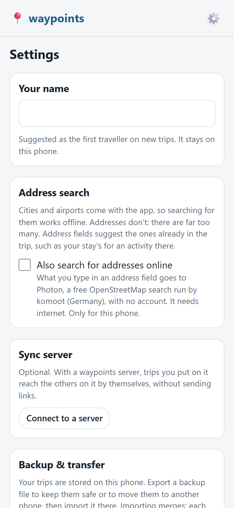

waypoints updates itself: a new version is picked up the next time you open the app, and your trips are
never touched by an update. If the app is already open, a banner says "A new version of waypoints is
ready": tap **Reload** to update now, or **Later**.

## 11. Questions

**Two of us changed the same thing. Whose wins?**
The newest edit. Everything else is kept: nothing anyone added is lost when changes come together.

**I'm offline. Does it work?**
Yes. Everything works without internet, including city and airport search. With a sync server, your
changes wait on your phone and go up when it can be reached.

**My link got cut off in the chat.**
Long trips make long links, and some chat apps cut them. Use **Save as a file** on the share screen
instead, send the file, and have the others open it with **Open a trip link or file**.

**I lost my phone.**
If the trip is on a sync server, ask the person who runs it (or use another of your phones) for a
**sign-in link**. It brings the new phone back as the same person, with all your trips. Don't join again
as a new member: that would be someone new, who can't see them. The lost phone can be disconnected there
too. Otherwise ask someone in the group to send you a link, or import a backup file if you have one. This is why a backup now
and then is worth it.

**How do I get updates?**
You don't have to do anything. A new version is picked up the next time you open the app. If it's already
open, a banner offers **Reload** or **Later**. Settings →
**✨ What's new** shows what changed.

**Can I use it with just one person, or only for myself?**
Yes. Add only yourself as a traveller, and ignore sharing.

**Can I take back a link I sent?**
No. Anyone who has the link can read that trip. Share links only with people you'd trust with it.
